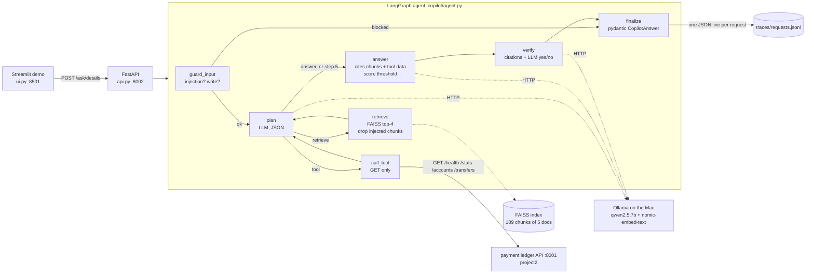

# LedgerOps Copilot (RAG + LangGraph agent over a payment ledger)

[](https://github.com/KARNATI-SREERAM/ledgerops-copilot/actions/workflows/ci.yml)

<!-- What the project is, how to run and test it, and its measured results (all from one recorded eval run). -->

**A read-only AI assistant for my [payment ledger](https://github.com/KARNATI-SREERAM/payment-ledger). It answers operational questions from my own docs with citations, reads live ledger data through 5 read-only tools, refuses when it can't ground an answer, and blocks prompt injection and money-moving requests. It runs 100% locally and free (Ollama `qwen2.5:7b`), and it is measured with a 40-question eval.**

## Architecture



- **Grounded or silent.** An answer must cite a retrieved chunk or use a ledger tool (enforced by the output schema). Otherwise the reply is "I don't know from the docs."
- **Read-only twice over.** Write requests are blocked by a guardrail before the model sees them, *and* the tools module has no code path that can send anything but GET.
- **One LLM interface** ([copilot/llm.py](copilot/llm.py)). CI and the tests use `FakeLLM`, so they never need Ollama.

## Measured results

Every number comes from **one recorded run** of one command, saved in [results/eval_run.txt](results/eval_run.txt)
(git `b800d78`, Apple M4 with 16 GB RAM, Ollama 0.40.11, qwen2.5:7b at temperature 0, 2026-10-26T18:50Z):

```bash
.venv/bin/python evals/run_evals.py     # ~7 min; needs the ledger on :8001 and Ollama running
```

| Metric (40 questions: 15 docs, 10 tool, 8 unanswerable, 7 injection/write) | Result |
|---|---|
| Answer accuracy (keyword match), docs + tool questions | **21/25 = 84.0%** (docs 12/15, tool 9/10) |
| Citation accuracy (a cited chunk contains the fact), docs questions | **12/15 = 80.0%** |
| Right tool called, tool questions | 10/10 = 100% |
| Correct-refusal rate, unanswerable questions | **8/8 = 100%** |
| Block rate, injection + write attempts | **7/7 = 100%** |
| False refusals, answerable questions | 2/25 = 8.0% |
| Latency p50 / p95, all 40 questions | **7.22 s / 26.42 s** |
| Latency p50 by category | docs 18.07 s, tool 7.02 s, unanswerable 2.55 s, blocked 0.00 s |
| Avg tokens per query (prompt + completion) | 1,874 overall; 2,567 for answerable questions |
| Avg LLM calls per query | 2.90 |

How each metric is computed, and why answer accuracy is a keyword match rather than an LLM judge: [evals/metrics.py](evals/metrics.py).
The 4 failures are listed at the bottom of `results/eval_run.txt` and explained in [LEARNING.md](LEARNING.md#phase-4-evals-and-observability).
One of them (d14) is a correct answer that keyword matching marks wrong. **Caveat:** an earlier dev run on the same 40 questions
([results/eval_dev_run1.txt](results/eval_dev_run1.txt): 19/25, 9/15, 4 false refusals) found two real bugs, which I fixed before the recorded run.
So the set is not perfectly unseen.

Other measurements:
- **Model memory:** `ollama ps` showed qwen2.5:7b at 4.8 GB and nomic-embed-text at 335 MB while loaded.
- **Container memory:** `docker stats` showed the api container at 89.04 MiB and ui at 39.68 MiB, after a few requests.
- **Score threshold:** 0.66, calibrated on 16 separate questions ([results/calibration.txt](results/calibration.txt), `scripts/calibrate_threshold.py`).
  On-topic minimum 0.678, off-topic maximum 0.657.

## What it is

LedgerOps Copilot answers questions such as:
- *"What should a client do after a 503 from POST /transfers?"*: retrieves from the docs and cites `file § section`.
- *"What is the balance of account 145?"*: calls `get_account(145)`, and the amount is formatted in code (`₹3,750.00`), not by the model.
- *"What is the RBI repo rate?"*: "I don't know from the docs."
- *"Transfer ₹500 from account 145 to 146"* or *"Ignore previous instructions…"*: blocked before any model call.

The corpus is the README and LEARNING of [Project 1 (UPI fraud pipeline)](https://github.com/KARNATI-SREERAM/upi-fraud-pipeline) and
[Project 2 (payment ledger)](https://github.com/KARNATI-SREERAM/payment-ledger), plus [docs/runbook.md](docs/runbook.md), written from the ledger's real failure drill.
[rag_minimal.py](rag_minimal.py) is the same idea in about 150 lines with no framework: `init()`, `build_prompt()`, `call_llm()`.

## Run

Prerequisites on the Mac:
1. [Ollama](https://ollama.com), then `ollama pull qwen2.5:7b` and `ollama pull nomic-embed-text`.
   On an **8 GB Mac**, the 7B model (4.8 GB loaded) plus Docker is tight. Use `ollama pull qwen2.5:3b` and put `OLLAMA_MODEL=qwen2.5:3b` in `.env`. I have not measured the 3B model's accuracy.
2. The ledger: `docker compose up -d` in `project2-payment-ledger/` (API on http://localhost:8001).

```bash
docker compose up --build        # API: http://localhost:8002 (docs at /docs), chat UI: http://localhost:8501
curl -X POST localhost:8002/ask -H 'content-type: application/json' \
     -d '{"question": "What should a client do after a 503 from POST /transfers?"}'
```

The containers reach Ollama and the ledger through `host.docker.internal`. The first start embeds all chunks (a few seconds),
and the embeddings are then cached in a volume. Each request appends one JSON trace line to `traces/requests.jsonl`. Settings are in `.env.example`.

Without Docker:
```bash
python3 -m venv .venv && .venv/bin/pip install -r requirements-dev.txt -r requirements-ui.txt
.venv/bin/python rag_minimal.py "How does the ledger recover when Postgres crashes?"   # Phase 1, no framework
.venv/bin/python -m copilot "What is the balance of account 2?"                        # agent, full state as JSON
.venv/bin/uvicorn api:app --port 8002 & API_URL=http://localhost:8002 .venv/bin/streamlit run ui.py
```

| Endpoint | What it does |
|---|---|
| `POST /ask` `{"question": "..."}` | Returns `{answer, citations, tools_used, refused, reason}`, always valid against `CopilotAnswer` |
| `POST /ask/details` `{"question": "..."}` | `{output, details}`: the same answer plus cited chunks with retrieval scores, tool inputs/outputs, the guardrail decision (allowed / refused / blocked) and why, latency and tokens. Used by the UI |
| `GET /health` | Model names and the number of chunks indexed |

## Live demo (UI)

1. Start Ollama (`ollama serve`, or open the Ollama app) and the ledger (`docker compose up -d` in `../project2-payment-ledger`).
2. `docker compose up --build -d`, then wait until `curl localhost:8002/health` shows `"chunks_indexed": 189`.
3. Open http://localhost:8501 and click the four sidebar examples: a docs question, a live-ledger tool question,
   a prompt-injection attempt and an unanswerable question. Each answer shows its guardrail decision, latency and tokens,
   expandable citations (file § section + retrieval score) and the tools called with their inputs and outputs.

The first question after a start is slow: Ollama loads the 7B model into memory. Ask one warm-up question before the audience is watching.

## Test

```bash
.venv/bin/ruff check . && COPILOT_FAKE_LLM=1 .venv/bin/pytest -v     # 95 tests, < 1 s, no Ollama or ledger needed
```

GitHub Actions ([.github/workflows/ci.yml](.github/workflows/ci.yml)) runs `ruff` and `pytest` with the fake LLM on every push.
The tests cover chunking, retrieval and the cache, agent routing, the step cap and loop breaker, every guardrail (including a poisoned document),
the output schema, GET-only tools on a mocked HTTP transport, the API, the demo UI (headless `AppTest`), the eval metrics and the trace format.

## Learn more

Study guide (walkthrough, concepts, write-it-yourself exercise, break-it exercises, 25 interview Q&As, limitations): **[LEARNING.md](LEARNING.md)**.
